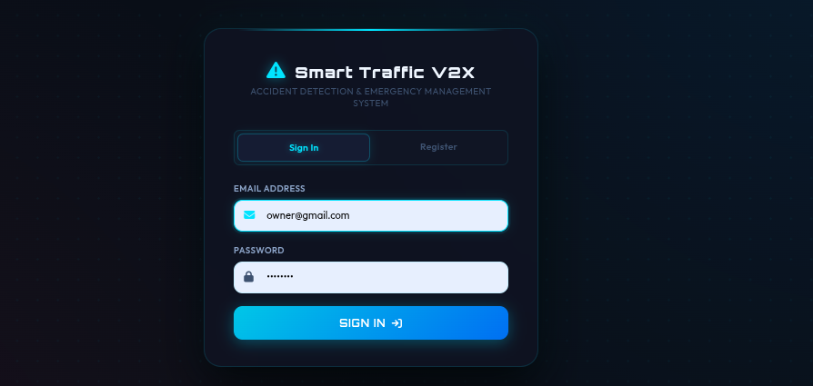
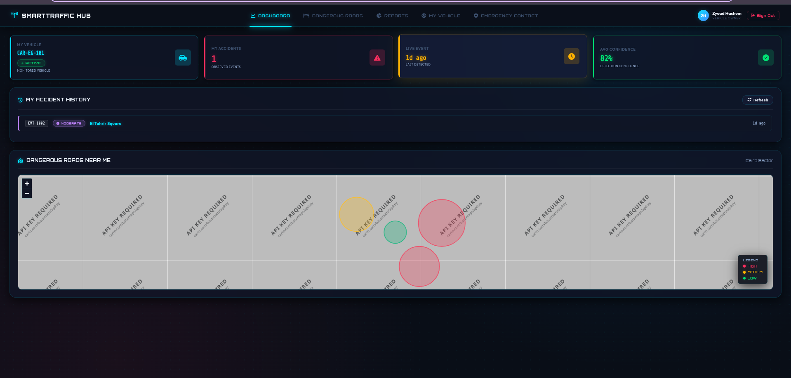
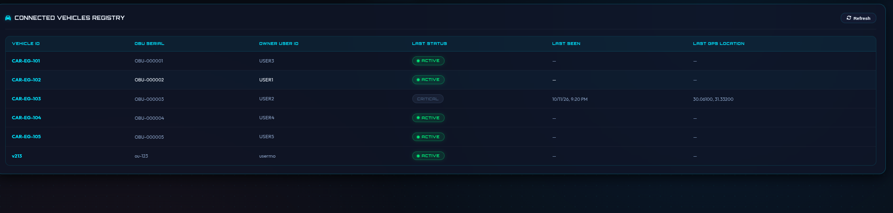
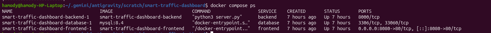
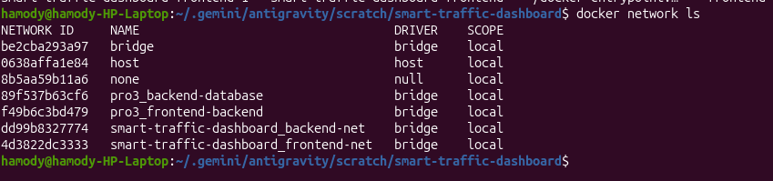
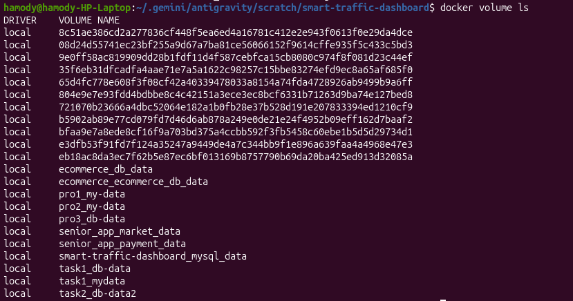
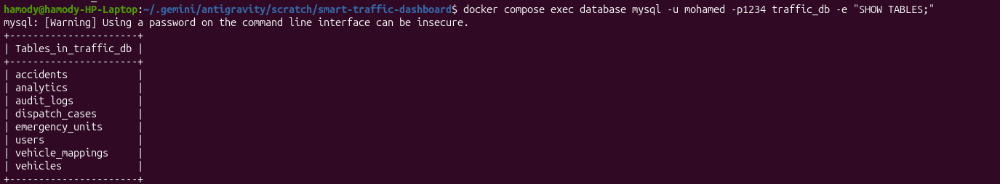

# Smart Traffic Dashboard — Docker Compose Lab

A self-initiated hands-on project built to apply and strengthen my understanding of Docker and Docker Compose as part of my ongoing DevOps learning journey.

---

## Overview

Smart Traffic Dashboard is a full-stack web application built with Python and MySQL, running as separate containers managed through Docker Compose.

The project demonstrates how to containerize a multi-tier application, serve static assets through Nginx as a reverse proxy, connect the backend to a dedicated database service, and manage all services using a single Compose configuration.

---

## Tech Stack

- **HTML, CSS, JavaScript** — Frontend dashboard (served by Nginx)
- **Python 3.12** — Backend REST API
- **MySQL 8.4** — Relational database
- **Nginx** — Static file server and reverse proxy
- **Docker** — Application containerization
- **Docker Compose** — Multi-container application management
- **Custom Bridge Networks** — Segmented communication between services
- **Named Volume** — Persistent database storage
- **Environment Variables** — Application configuration
- **SQL Initialization Script** — Database schema and sample data setup

---

## Architecture

The application consists of three main services:

**Frontend (Nginx):** Serves the static dashboard files (HTML, CSS, JS) and reverse-proxies all `/api/` requests to the backend service.

**Backend (Python API):** Handles HTTP requests, processes business logic, and reads/writes data from MySQL (vehicles, incidents, dispatch cases, user authentication).

**Database (MySQL 8.4):** Stores all application data including vehicles, users, accidents, and dispatch records.

Docker Compose manages all services and their configuration.

The services communicate through two custom Docker bridge networks:

- **`frontend-net`** — Connects Nginx and the Python API. The frontend container exposes port `8080` on the host.
- **`backend-net`** — Connects the Python API and MySQL only. Configured as `internal: true`, meaning the database container has no external internet access.

A named volume (`mysql_data`) stores MySQL data at `/var/lib/mysql` inside the container, allowing it to persist when the database container is recreated, provided the volume is retained.

A SQL initialization script creates all required tables and inserts sample data during the initial database setup.

---

## Network Design

| Network | Driver | Subnet | Gateway | Access |
|---|---|---|---|---|
| `frontend-net` | bridge | `172.30.10.0/24` | `172.30.10.1` | Frontend container exposes port 8080 on host |
| `backend-net` | bridge | `172.30.20.0/24` | `172.30.20.1` | Internal only (`internal: true`) |

---

## API Endpoints

The application is accessible at:

```
http://localhost:8080
```

| Endpoint | Method | Description |
|---|---|---|
| `/` | GET | Serves the main dashboard |
| `/api/login` | POST | User authentication |
| `/api/register` | POST | New user registration |
| `/api/vehicles` | GET | Retrieve all registered vehicles |
| `/api/accidents` | GET | Retrieve accident/incident records |
| `/api/dispatch-cases` | GET | Retrieve dispatch case logs |
| `/api/analytics` | GET | Retrieve traffic analytics data |
| `/api/users` | GET | Retrieve user list (admin) |

> **Note:** Most API endpoints require authentication. Send a POST request to `/api/login` first to obtain a session token.

**Example Request:**

```bash
curl http://localhost:8080/api/vehicles
```

---

## Prerequisites

- Docker Engine
- Docker Compose
- Git

---

## Run Locally

### 1. Open the project directory

```bash
cd smart-traffic-dashboard
```

### 2. Configure environment variables

Copy the example file and fill in your values:

```bash
cp .env.example .env
```

Then open `.env` and set your database credentials.

> **Note:** The `.env` file is excluded from version control to avoid exposing credentials.

### 3. Build and start the application

```bash
docker compose up -d --build
```

### 4. Check the running containers

```bash
docker compose ps
```

### 5. Test the application

Open your browser and navigate to:

```
http://localhost:8080
```

---

## Screenshots

### Login Page



---

### Dashboard



---

### Connected Vehicles Registry



---

### Running Containers — `docker compose ps`



---

### Docker Networks — `docker network ls`



---

### Docker Volumes — `docker volume ls`



---

### Database Tables — `SHOW TABLES`



---

## Data Persistence

MySQL data is stored in a Docker named volume (`mysql_data`) mounted at `/var/lib/mysql` inside the database container. This allows database data to survive container recreation as long as the volume is preserved.

> **Note:** The SQL initialization script runs only when MySQL initializes a new, empty data directory. Restarting an existing database container does not rerun the initialization script.

---

## Useful Commands

```bash
# View logs for all services
docker compose logs -f

# View logs for a specific service
docker compose logs backend

# Open a MySQL session inside the container
docker compose exec database mysql -u mohamed -p traffic_db

# Inspect the isolated backend network
docker network inspect smart-traffic-dashboard_backend-net
```

> ⚠️ **Destructive command — deletes all persistent data:**
> ```bash
> docker compose down -v
> ```
> This removes the `mysql_data` named volume and permanently deletes all database data. Only use this for a full reset.

---

## Learning Outcomes

Through this hands-on lab, I practiced:

- Containerizing a Python backend and a MySQL database.
- Serving a static frontend through Nginx acting as a reverse proxy.
- Implementing network segmentation using two isolated custom bridge networks.
- Preventing direct external access to the database using `internal: true`.
- Configuring services using environment variables.
- Initializing a database using SQL scripts via `docker-entrypoint-initdb.d`.
- Persisting database data with Docker named volumes.
- Managing service dependencies between three containers using Docker Compose.
- Deploying and managing a multi-container application end to end.

---

## Author

An independent hands-on lab created while learning Docker and DevOps.
